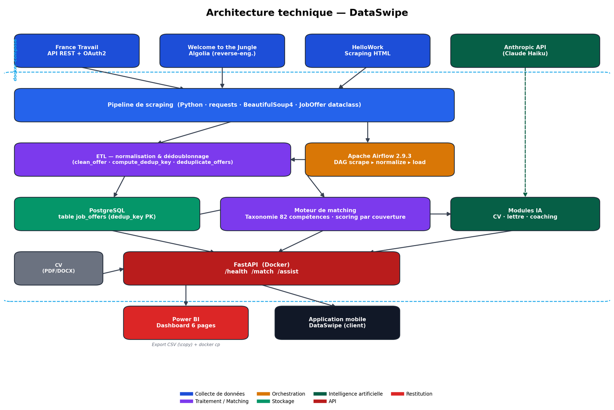
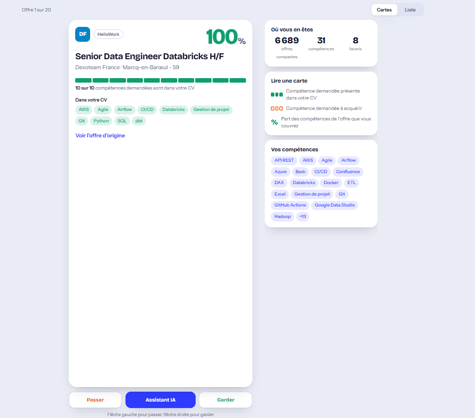
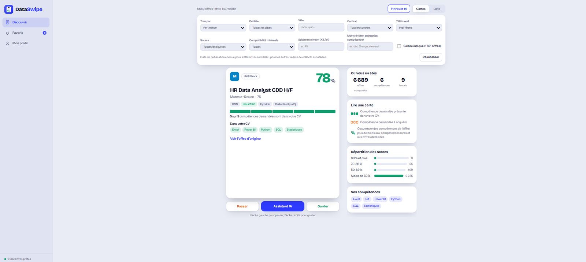
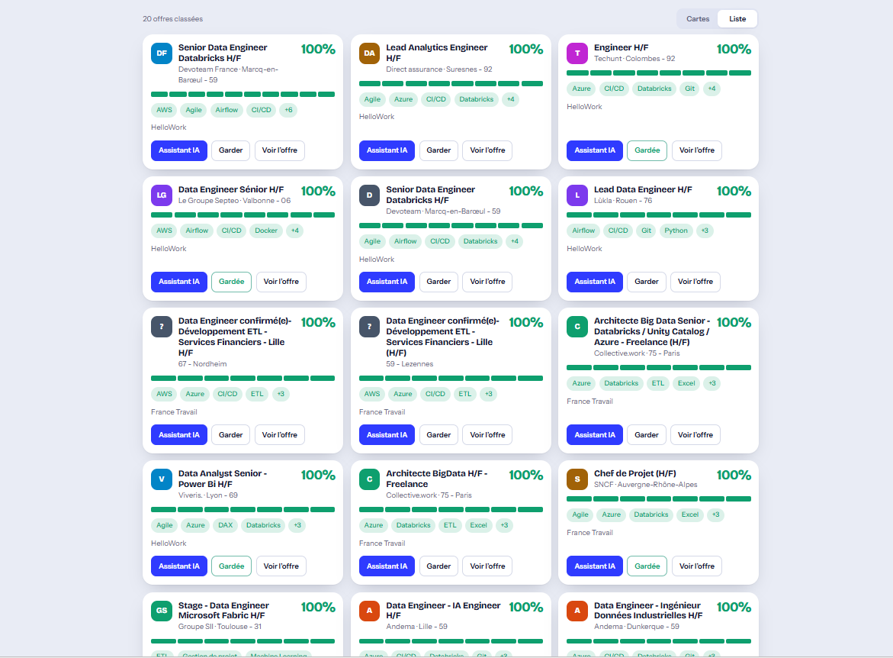
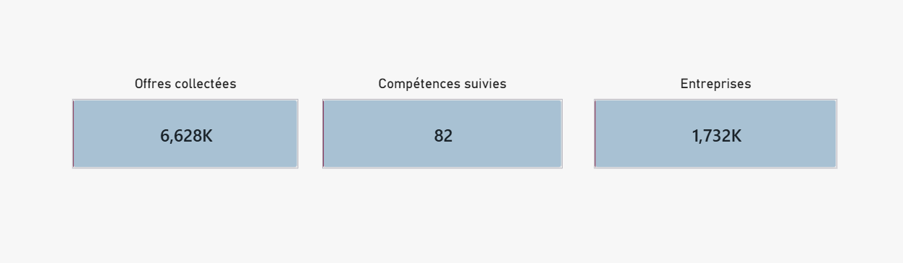
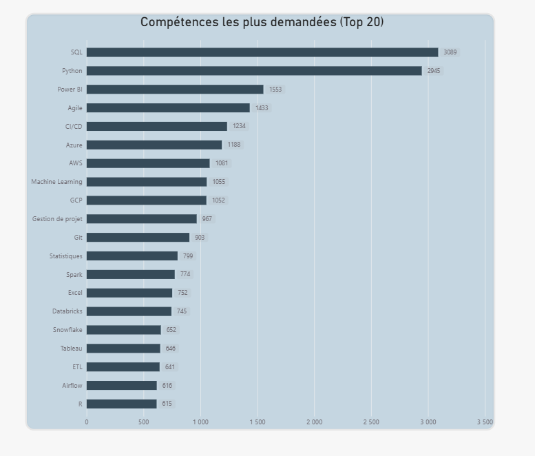
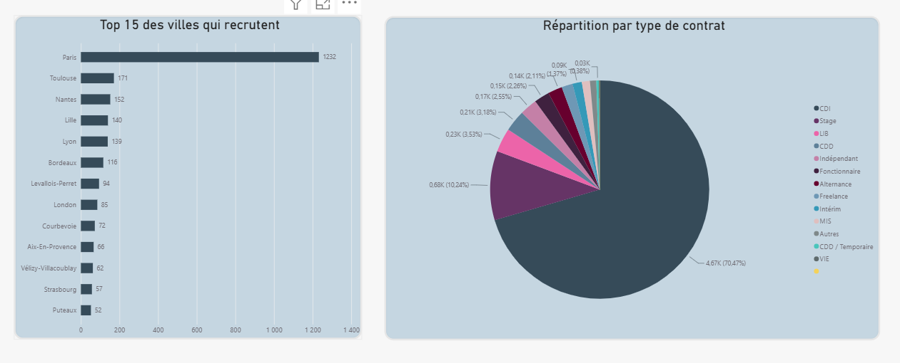

# DataSwipe

Plateforme Big Data de collecte et d'analyse des offres d'emploi, avec une application web de matching
« à la Tinder » : on dépose son CV, DataSwipe le compare à toutes les offres collectées et classe celles qui
correspondent. Projet de fin d'études (PFE).

## Aperçu



*Architecture : 3 sources, ETL, PostgreSQL, Airflow, API FastAPI, application web et Power BI.*

### Application web

| Vue « cartes » | Filtres et tri |
|---|---|
|  |  |



### Tableau de bord Power BI



| Compétences les plus demandées | Villes et types de contrat |
|---|---|
|  |  |

Modèle de données : [schéma en étoile](docs/images/schema_etoile_powerbi.png) · Planning : [diagramme de Gantt](docs/images/gantt.png)

## Ce que fait le projet

| Couche | Rôle | Technologies |
|---|---|---|
| Collecte | 3 sources : API France Travail, Welcome to the Jungle (Algolia), HelloWork (HTML) | Python, requests |
| ETL | nettoyage, normalisation, déduplication (titre + entreprise + ville), salaires aberrants écartés | Python |
| Stockage | table `job_offers` (clé `dedup_key`, upsert) | PostgreSQL 16 |
| Orchestration | DAG quotidien `dataswipe_daily` : collecte, ETL, chargement, purge des offres expirées, export, alerte | Apache Airflow 2.9 |
| Matching | référentiel de 82 compétences, score = couverture pondérée par rareté (IDF) × fiabilité | Python |
| API | `/match`, `/search`, `/assist`, `/export`, `/health` | FastAPI |
| Application | interface responsive : filtres, favoris et suivi de candidatures, assistant IA | HTML/JS sans framework |
| Assistant IA | coaching, lettre de motivation, CV adapté ; niveau d'expérience calculé par le code, en-têtes et coordonnées issus de « Mon profil », photo facultative, export Word/PDF | API Anthropic |
| Décisionnel | tableau de bord 6 pages alimenté par des CSV exportés | Power BI |

Le matching, la recherche et l'export sont locaux et gratuits ; seul l'assistant appelle l'API Anthropic
(payante), protégé par un cache et des limites (`pipeline/api/limits.py`).

## Démarrage

Prérequis : Docker Desktop.

```bash
cp .env.example .env        # puis renseigner les valeurs (voir ci-dessous)
docker-compose up -d
```

- Application : http://127.0.0.1:8000
- Airflow : http://127.0.0.1:8080 (changer le mot de passe par défaut dès le premier lancement)

Les ports sont volontairement liés à `127.0.0.1` ; PostgreSQL n'est pas publié.

### Variables d'environnement

Voir `.env.example` : identifiants France Travail, mot de passe PostgreSQL, clé `ANTHROPIC_API_KEY`,
`ASSIST_MODEL` (modèle de l'assistant), limites `ASSIST_*`, `NTFY_TOPIC` (alertes push).
**Le fichier `.env` ne doit jamais être versionné.**

## Sécurité

- Aucune authentification dans cette version : ne pas exposer l'application sur Internet en l'état.
- Changer les mots de passe par défaut avant tout test externe.
- Le CV déposé est analysé en mémoire et n'est pas conservé ; la photo reste dans le navigateur et n'est
  transmise que lors du téléchargement du document.
- Si une clé a été exposée (capture, discussion, dépôt), la révoquer et en créer une nouvelle.

## Limites connues

- L'ordinateur doit rester allumé pour que le pipeline tourne seul (remède : hébergement cloud).
- Power BI Desktop se rafraîchit manuellement (remède : Power BI Service + passerelle).
- Le score n'est pas calibré sur un jeu d'évaluation humaine.
- Les garde-fous de coût de l'assistant n'ont pas été éprouvés en conditions réelles.
- Les scrapers dépendent de la structure des sites sources et peuvent casser à tout changement.

## Structure

```
docker-compose.yml
pipeline/
  api/        FastAPI + application web (static/)
  ai/         assistant IA (profil, CV adapté, lettre, coaching)
  dags/       DAG Airflow
  etl/        normalisation, chargement, maintenance, tables Power BI
  matching/   taxonomie de compétences, score
  …           collecte des 3 sources (scrapers)
```
